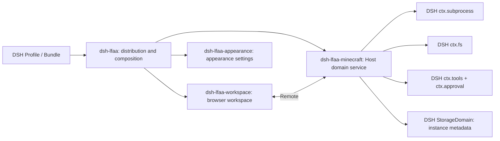

# Phase 2: Repository Audit and Architecture Skeleton

English | [中文](phase-2-audit.zh.md)

Date: 2026-10-15

## Audit conclusions

1. Preserve the three existing owners: dsh-lfaa, dsh-lfaa-workspace, and dsh-lfaa-appearance.
2. Minecraft belongs in one new domain package. Create dsh-lfaa-minecraft when Phase 3 begins real implementation; do not create an empty package now.
3. Do not split distribution catalogs, Java, process, storage, or backup packages in the first implementation. Split a responsibility only when it has an independent consumer or a replaceable implementation.
4. One Host domain service owns Minecraft operations. Agent tools and the browser workspace call that service instead of implementing server startup separately.
5. DSH exposes public seams for processes, files, tool policy and approval, Host-to-browser Remotes, and non-session persistence. Integration must still verify that the active profile mounts the required providers and that path and permission behavior works on the target OS.
6. This phase changed DSH-LFAA documentation only. No DSH source or business code was changed, and no package was created.

## Audit baseline

| Repository | Version and revision at audit | Worktree |
|---|---|---|
| deepseek-harness | 0.2.1-alpha.3, master commit 571902028a75c64c1d767f4ae5fd099485f0ddf0 | Had existing user changes; this phase did not edit or clean them. |
| dsh-lfaa | 0.1.0, main branch | Existing changes were preserved; this phase added the audit record and updated adjacent document status. |

The DSH baseline comes from the local worktree. The installed runtime, npm artifact, and GitHub default branch still need separate checks during compatibility acceptance; matching version numbers alone do not prove compatibility.

## DSH plugin installation contract

DSH Plugin Manager accepts registry package names, Git repository addresses, tarballs, and absolute local paths. Each form resolves differently:

| Input | Requirements | npm publication required first? |
|---|---|---|
| Package name, such as dsh-lfaa | The selected registry must return the version; the package manifest must declare dsh.bundle | Yes |
| GitHub repository URL | pnpm can reach GitHub; the root package.json declares dsh.bundle; the installed package must pass bundle validation | No |
| Local directory | Use an absolute path; the directory has a readable package.json declaring dsh.bundle | No |

The dsh-lfaa repository root manifest points its distribution entry at the root dist/packages/dsh-lfaa. GitHub installs use the committed build output and do not run a prepare script; the GitHub push menu refreshes that output before staging. A local source-directory install still requires building first. Changing the npm registry changes where registry packages and dependencies are fetched; it does not fix an unreachable GitHub host.

The user previously reported that dsh-lfaa@0.1.0 installed by package name. That confirms the registry installation path is available. It does not show that GitHub and local directory installs were each tested, or that Minecraft services exist.

Evidence: DSH's [install-spec.ts](https://github.com/deepseek-ai/deepseek-harness/blob/571902028a75c64c1d767f4ae5fd099485f0ddf0/packages/boot/plugin-manager/src/install-spec.ts), [Plugin Manager implementation](https://github.com/deepseek-ai/deepseek-harness/blob/571902028a75c64c1d767f4ae5fd099485f0ddf0/packages/boot/plugin-manager/src/index.ts), and [installation UI guide](https://github.com/deepseek-ai/deepseek-harness/blob/571902028a75c64c1d767f4ae5fd099485f0ddf0/packages/client/ui-plugin-manager/README.md).

## Current dsh-lfaa implementation

| Package or area | Current responsibility | Not implemented |
|---|---|---|
| [dsh-lfaa](../packages/dsh-lfaa/package.json) | Repository-root distribution facade; builds one installable bundle and provides its patch, Host manifest, and Config export. Host apply is currently empty. | Minecraft domain services, instance state, Agent tools, process startup, and download flow. |
| [dsh-lfaa-workspace](../packages/dsh-lfaa-workspace/README.md) | Registers DSH-native navigation, main workspace, Session view, right pane, and settings; displays appearance controls and a sample preview. | Minecraft business UI and live server state. |
| [dsh-lfaa-appearance](../packages/dsh-lfaa-appearance/README.md) | Owns the current Profile-level appearance Config schema and reversible DSH theme-token projection. | General business settings, server metadata, or game files. |

The build script inlines private workspace packages into the repository-root dist/packages/dsh-lfaa and removes private dependencies from the published manifest. The source package directory and built distribution directory are different install targets; GitHub and local directory installs use the repository-root manifest, with GitHub consuming the committed build output.

Existing tests use Node's native test runner and cover package naming, appearance-token projection, and UI registration and cleanup. They do not exercise installation or activation in a real DSH Profile, or Minecraft startup and process recovery.

## Confirmed DSH extension capabilities

The public capability-seam documents and package source in DSH 0.2.1-alpha.3 confirm:

- Cordis effects own registration and teardown; each plugin disposes the resources it registers.
- ctx.subprocess resolves executables, starts child processes with explicit argv, reads bounded output, and terminates managed process ranges. Callers own business timeouts, readiness rules, and stop policies.
- ctx.fs provides path resolution, file reads and writes, directory listing, and atomic updates; available operations depend on the mounted filesystem provider and sandbox policy.
- ctx.tools registers Agent-callable tools. tools/pre-execute, ctx.approval, and monotonic guards form DSH's policy and one-shot approval path. Domain code still validates arguments, instance ownership, and concurrency.
- Typert Remote exposes Host services to the browser Client. The browser should call a public domain contract rather than access Host files or processes directly.
- ctx.storageDomain persists schema-validated, non-session business records. The profile must also mount the storage hub, a backend, and the domain provider. It suits instance metadata, not server binaries, world files, or backups.

References: [capability-seams.md](https://github.com/deepseek-ai/deepseek-harness/blob/571902028a75c64c1d767f4ae5fd099485f0ddf0/docs/capability-seams.md), [tool-execution-pipeline.md](https://github.com/deepseek-ai/deepseek-harness/blob/571902028a75c64c1d767f4ae5fd099485f0ddf0/docs/tool-execution-pipeline.md), [subprocess package guide](https://github.com/deepseek-ai/deepseek-harness/blob/571902028a75c64c1d767f4ae5fd099485f0ddf0/packages/subprocess/subprocess/README.md), and [storage-domain package guide](https://github.com/deepseek-ai/deepseek-harness/blob/571902028a75c64c1d767f4ae5fd099485f0ddf0/packages/storage/storage-domain/README.md).

## Architecture skeleton

| Owner | Responsibility | Constraint |
|---|---|---|
| dsh-lfaa | Single distribution package, Bundle/Host composition, and public plugin identity | Composes dependencies and configuration; does not own Minecraft business rules. |
| dsh-lfaa-minecraft (created in Phase 3) | Host-side Minecraft domain service, instance lifecycle, distribution adapter boundary, and model tools | Complete the first real loop in one domain package; use DSH subprocess/fs/tools/approval capabilities. |
| dsh-lfaa-workspace | DSH-native card workspace, instance views, and settings page | Renders domain results and submits intent; keeps no second instance state. |
| dsh-lfaa-appearance | Appearance Config schema and reversible theme projection | Remains responsible for appearance, not Minecraft settings. |
| DSH Remote and StorageDomain | Host domain API for the Client and persistence of small structured business metadata | Confirm profile provider composition, identity scope, migration, and uninstall behavior before finalizing. |

Users must be able to choose a movable data root for game instances, separate from DSH_HOME, Profile configuration, and Session logs. Server files and world data stay under that root; structured instance records and references belong in StorageDomain or another confirmed metadata store. The selection, permission, migration, and backup behavior must be implemented against DSH's actual path capabilities; no drive letter or final path variable is selected yet.

Target flow: DSH Agent tools and the browser workspace call the same Minecraft Host domain service, which uses DSH file and subprocess capabilities. DSH StorageDomain persists domain metadata. This keeps UI and Agent behavior on one implementation path.

## Architecture gaps

| Goal | Evidence today | Follow-up |
|---|---|---|
| Agent can operate Minecraft | Host apply is empty; no domain tool registration was found | The Minecraft owner registers tools and uses DSH's native approval policy in Phase 3. |
| Real server lifecycle | No Java detection, distribution metadata, verified downloads, startup, readiness, console, or stop implementation exists | Implement and run one real distribution first. The prompt's user example names Minecraft Java Paper 1.21.1; use it as the provisional first acceptance target, subject to confirmation before implementation. |
| UI and tools share business logic | Workspace currently consumes only appearance ConfigForms | Expose one Host domain service through the Remote and tool interfaces. |
| Movable durable data | The current persistent data is appearance Profile configuration | Separate structured metadata from server files and let the user choose the data root. |
| Real installation compatibility | Package-name installation was reported by the user; Git and local paths have no separate recorded run evidence | Record DSH version, source, input form, activation result, and errors or screenshot; track installation and activation separately. |

## Next phases

1. Phase 2 (this phase): repository audit, package owners, public seams, data boundaries, and architecture gaps are recorded.
2. Phase 3: create the single Minecraft domain package and implement the Java Edition Paper 1.21.1 Windows server loop from the prompt's example: instance creation, Java check, official build discovery, verified download, server installation, real readiness, console, stop, restart recovery, and error reporting. Check current Paper sources before implementation; do not hardcode a stale build list.
3. Phase 4: add Agent tools, workspace, settings, Skills/terminal integration, and formal plugin acceptance on the same domain service. Expand to more distributions only when there is a real requirement.

No tests, build, or DSH-instance acceptance were run in this phase. Before Phase 3 implementation, confirm Paper 1.21.1 as the first distribution acceptance target. Unless redirected, this plan treats the prompt's example as the provisional default.

