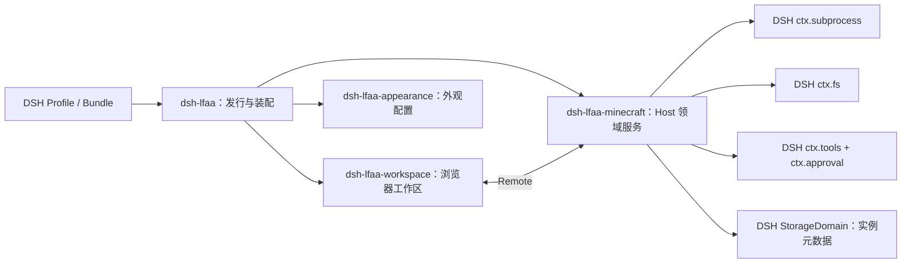

# 第二阶段：仓库审计与架构骨架

[English](phase-2-audit.md) | 中文

日期：2026-10-15

## 审计结论

1. 保留现有三个职责包：dsh-lfaa、dsh-lfaa-workspace、dsh-lfaa-appearance。
2. Minecraft 业务应由一个新增的领域包承接；推荐在第三阶段开始真实实现时创建 dsh-lfaa-minecraft。当前不创建空包。
3. 首期不拆分发行版目录、Java、进程、存储和备份等包。只有出现独立消费者或可独立替换的实现后，再按职责拆分。
4. Host 领域服务是 Minecraft 操作的唯一 Owner；Agent 工具和浏览器工作区都调用同一领域服务，不各自实现开服逻辑。
5. DSH 提供了正式的进程、文件、工具审批、Host 到浏览器 Remote 和非会话持久化扩展点。接入时仍须检查实际 profile 是否装配相应 provider，并验证本机与目标系统的路径及权限行为。
6. 本阶段只修改 DSH-LFAA 文档，没有改动 DSH 基座或业务源码，也没有创建新包。

## 审计基线

| 仓库 | 审计时版本与修订 | 工作区情况 |
|---|---|---|
| deepseek-harness | 0.2.1-alpha.3，master 提交 571902028a75c64c1d767f4ae5fd099485f0ddf0 | 存在用户已有未提交修改；本阶段未修改或清理。 |
| dsh-lfaa | 0.1.0，main 分支 | 保留原有工作区修改；本阶段只添加阶段审计文档并更新相邻文档状态。 |

DSH 基线来自本机工作树。运行时安装版本、npm 发行物与 GitHub 默认分支仍需在正式兼容验收时分别核对，不能仅凭版本号相等推断兼容。

## DSH 的插件安装合同

DSH Plugin Manager 接受 registry 包名、Git 仓库地址、tarball 和本地绝对路径。来源不同，解析方式也不同：

| 输入 | 必要条件 | 是否要求先发布 npm |
|---|---|---|
| 包名，例如 dsh-lfaa | 所选 registry 能查到该版本；包清单必须声明 dsh.bundle | 是 |
| GitHub 仓库 URL | pnpm 能访问 GitHub；仓库根 package.json 声明 dsh.bundle，安装后的包仍须通过 bundle 校验 | 否 |
| 本地目录 | 使用绝对路径；目录含可读取的 package.json 并声明 dsh.bundle | 否 |

DSH 对 dsh-lfaa 的仓库根路径检查发现：根清单将发行入口指向仓库根 dist/packages/dsh-lfaa，并声明 prepare 构建脚本。因此，从本地源码目录安装前须确保这份产物已构建；Git 安装也须以实际 Git 分支中的清单、构建脚本和 pnpm 生命周期策略为准。如果安装器拦截构建脚本，需要在 DSH 的安装流程中按提示处理。更换 npm registry 只会改变包及依赖的 registry 获取位置，不能修复 GitHub 主机不可达。

用户此前已报告 dsh-lfaa@0.1.0 可通过包名安装；这证明该 registry 安装入口可用。此证据不代表 GitHub 和本地目录入口已分别实测，也不代表 Minecraft 服务功能已存在。

核对依据：DSH 的 [install-spec.ts](https://github.com/deepseek-ai/deepseek-harness/blob/571902028a75c64c1d767f4ae5fd099485f0ddf0/packages/boot/plugin-manager/src/install-spec.ts)、[Plugin Manager 实现](https://github.com/deepseek-ai/deepseek-harness/blob/571902028a75c64c1d767f4ae5fd099485f0ddf0/packages/boot/plugin-manager/src/index.ts) 与 [安装界面说明](https://github.com/deepseek-ai/deepseek-harness/blob/571902028a75c64c1d767f4ae5fd099485f0ddf0/packages/client/ui-plugin-manager/README.md)。

## dsh-lfaa 当前实现

| 包或区域 | 当前代码职责 | 当前没有提供 |
|---|---|---|
| [dsh-lfaa](../packages/dsh-lfaa/package.json) | 仓库根发行门面；构建单一可安装包，提供 bundle patch、Host 清单和 Config 导出。Host apply 当前为空。 | Minecraft 领域服务、实例状态、Agent 工具、进程启动与下载流程。 |
| [dsh-lfaa-workspace](../packages/dsh-lfaa-workspace/README.zh.md) | 注册 DSH 原生菜单、主工作区、会话视图、右侧栏和设置区；显示外观设置及示例预览。 | Minecraft 业务 UI、与真实服务器状态的联动。 |
| [dsh-lfaa-appearance](../packages/dsh-lfaa-appearance/README.zh.md) | 拥有当前 Profile 级外观配置 Schema，安装可撤销的 DSH 主题令牌投影。 | 通用业务设置、服务器元数据或游戏文件。 |

构建脚本把私有 workspace 包内联到仓库根 dist/packages/dsh-lfaa，并删除发行清单中的私有依赖。根 package.json 的 prepare 会触发该构建。源码包目录与构建产物目录不是同一个安装目标；本地目录入口按仓库根清单安装。

现有测试为 Node 原生测试，覆盖命名门禁、外观令牌投影与 UI 扩展登记及卸载清理。它们不是 DSH Profile 下的真实安装、激活、Minecraft 启动或进程恢复验收。

## 已确认的 DSH 扩展能力

DSH 0.2.1-alpha.3 的公开 capability seam 文档与包源码确认：

- Cordis effect 可管理注册与卸载；每项资源应由注册它的插件清理。
- ctx.subprocess 用于解析可执行程序、启动显式 argv 子进程、读取有界输出并终止受管理的进程范围。它不会替调用方决定业务超时、就绪规则或停止策略。
- ctx.fs 提供路径解析、文件读写、目录枚举和原子更新；具体能力受当前安装的 filesystem provider 与 sandbox policy 约束。
- ctx.tools 注册 Agent 可调用工具；tools/pre-execute、ctx.approval 和单调 Guard 提供 DSH 的策略与一次性审批链。领域操作仍需自行校验参数、实例归属与并发。
- Typert Remote 可把 Host 服务公开给浏览器 Client。浏览器只通过领域公开的远程合同查看与操作实例，不直接访问 Host 文件或进程。
- ctx.storageDomain 可持久化经 Schema 校验的非 Session 业务记录；必须在 profile 中一并装配 storage hub、backend 和 domain provider。它适合实例元数据，不适合存放服务端二进制文件、世界文件或备份包。

入口参考：[capability-seams.md](https://github.com/deepseek-ai/deepseek-harness/blob/571902028a75c64c1d767f4ae5fd099485f0ddf0/docs/capability-seams.md)、[tool-execution-pipeline.md](https://github.com/deepseek-ai/deepseek-harness/blob/571902028a75c64c1d767f4ae5fd099485f0ddf0/docs/tool-execution-pipeline.md)、[subprocess 包说明](https://github.com/deepseek-ai/deepseek-harness/blob/571902028a75c64c1d767f4ae5fd099485f0ddf0/packages/subprocess/subprocess/README.md)、[storage-domain 包说明](https://github.com/deepseek-ai/deepseek-harness/blob/571902028a75c64c1d767f4ae5fd099485f0ddf0/packages/storage/storage-domain/README.md)。

## 架构骨架

| Owner | 负责内容 | 约束 |
|---|---|---|
| dsh-lfaa | 单一发行包、Bundle/Host 装配与公共插件身份 | 只装配依赖和配置，不承载 Minecraft 业务规则。 |
| dsh-lfaa-minecraft（第三阶段创建） | Host 侧 Minecraft 领域服务、实例生命周期、发行版适配边界和模型工具 | 先在一个领域包内完成真实闭环；通过 DSH subprocess/fs/tools/approval 能力执行。 |
| dsh-lfaa-workspace | DSH 原生卡片式工作区、实例视图和设置页面 | UI 只展示领域服务结果并提交意图；不维护第二份实例状态。 |
| dsh-lfaa-appearance | 外观偏好 Schema 和可撤销主题投影 | 保持 UI 外观职责，不承接 Minecraft 配置。 |
| DSH Remote 与 StorageDomain | 为 Client 提供 Host 领域接口，并持久化小型结构化业务元数据 | 确认 profile provider 装配、身份范围、版本迁移和卸载策略后再确定配置。 |

游戏实例文件应由用户指定可移动的数据根目录管理，和 DSH_HOME、Profile 配置、Session 日志分开。每个实例的服务端文件与世界数据留在该数据根目录；数据库或 StorageDomain 仅保存经过校验的实例清单和引用。数据根目录如何选择、授权、迁移及备份策略，需要在第三阶段按 DSH 的实际路径能力实现，当前不创建固定盘符或最终目录变量。

目标数据流：DSH Agent 工具与浏览器工作区 → 同一个 Minecraft Host 领域服务 → DSH 文件与子进程能力；领域元数据经 DSH StorageDomain 持久化。由此避免 UI 与 Agent 各自实现一套开服逻辑。

## 架构差异清单

| 目标 | 当前证据 | 后续工作 |
|---|---|---|
| Agent 可操作 Minecraft | 当前 Host apply 为空，未发现领域工具登记 | 第三阶段由 Minecraft Owner 注册工具，并通过 DSH 原生审批策略。 |
| 真实服务端生命周期 | 当前无 Java 检测、发行版元数据、下载校验、启动、就绪、控制台或停止实现 | 先按单一发行版实现并真实运行验证。提示词中的用户示例为 Minecraft Java Paper 1.21.1；据此作为首期候选验收目标，待开工前确认。 |
| UI 与工具共享业务能力 | 当前 Workspace 仅消费外观 ConfigForm | 通过一个 Host 领域服务和公开 Remote/工具接口共享状态与规则。 |
| 可移动持久数据 | 当前只有外观 Profile 配置 | 结构化元数据与服务器文件分离；用户可选择数据根目录。 |
| 实际安装兼容验收 | 包名安装已由用户报告成功；Git 和本地路径未分别留存运行证据 | 记录 DSH 版本、来源、输入、激活结果和错误/截图；安装成功与插件激活分开记录。 |

## 后续顺序

1. 第二阶段（本次）：源码审计、包 Owner、公开 seam、数据边界和差异清单已落档。
2. 第三阶段：创建唯一的 Minecraft 业务包；先实现提示词示例范围内的 Paper 1.21.1 Java Edition Windows 开服闭环，覆盖实例创建、Java 检查、官方构件发现、校验下载、服务端安装、真实就绪、控制台、停止、重启恢复和错误反馈。下载来源和版本接口需在实现前对照 Paper 官方文档，不能硬编码过期清单。
3. 第四阶段：在同一领域服务上完成 Agent 工具、工作区、设置、Skills/终端集成及插件级正式验收；按实际需求再扩展发行版。

本次没有运行测试、构建或 DSH 实例验收。下一阶段开始实现前，先确认 Paper 1.21.1 是否作为首个发行版验收目标；若用户未作其他指定，本规划以提示词示例作为暂定默认值。

